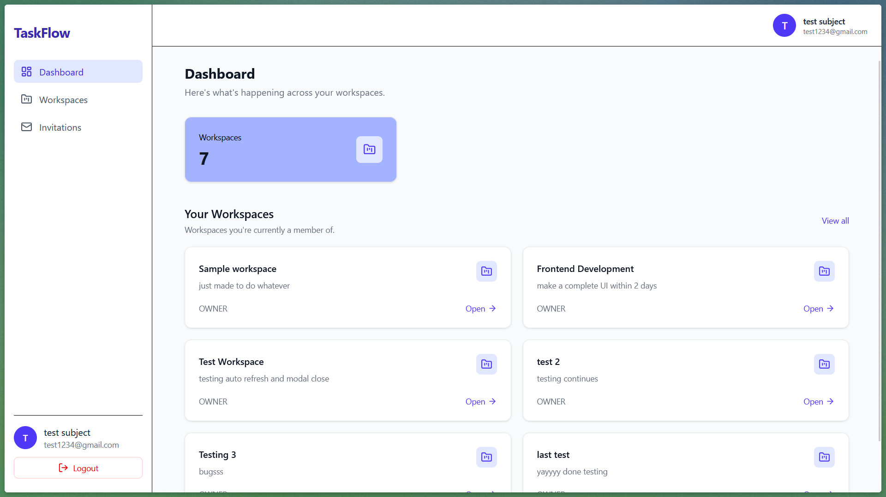
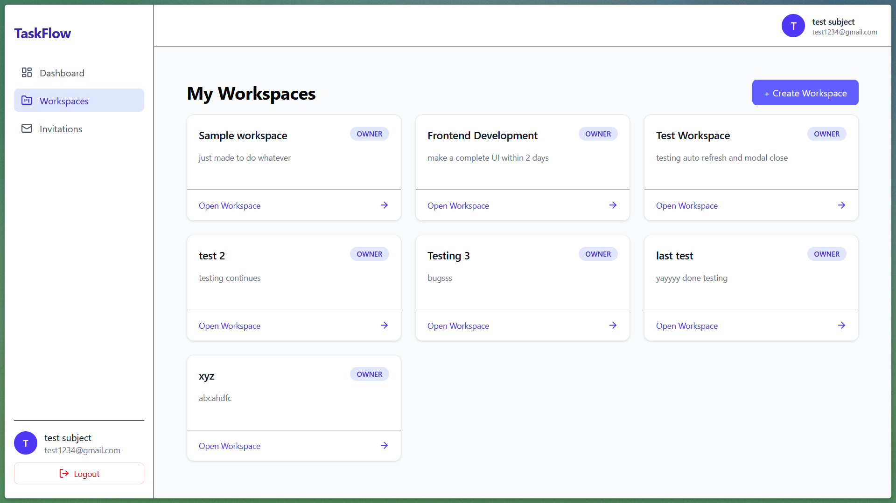
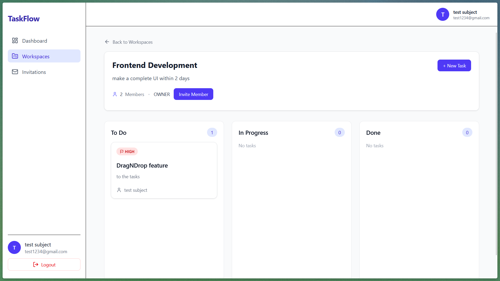
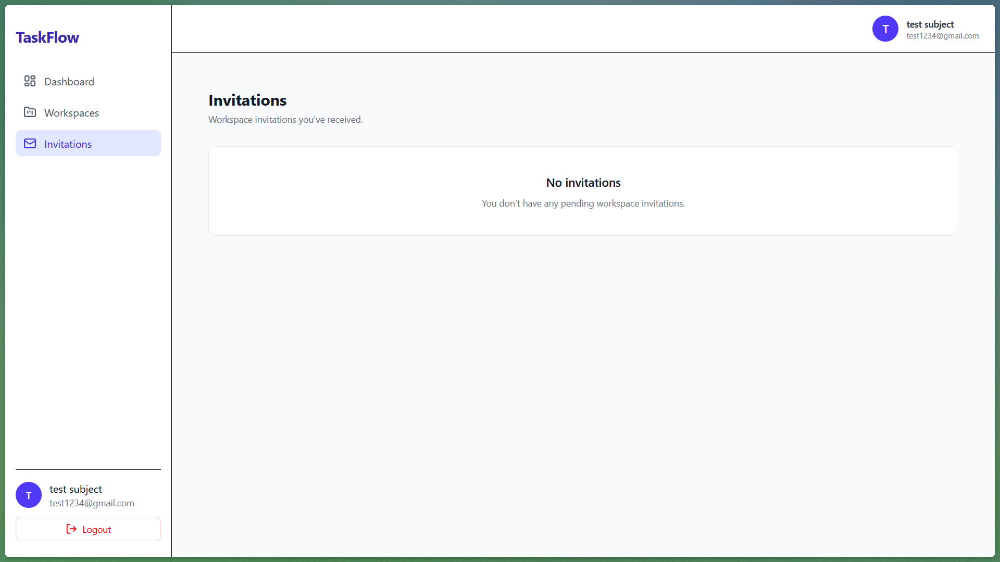

# TaskFlow

TaskFlow is a full-stack project management application inspired by tools like Trello. It allows users to create workspaces, collaborate with members, manage tasks, and organize work through a Kanban-style task board.

The project was built to practice and demonstrate full-stack development using TypeScript, React, Express, PostgreSQL, Prisma, and modern authentication and API patterns.

---

## Screenshots

### Dashboard



### Workspace Page



### Kanban Board




### Workspace Invitations



---

## Features

### Authentication

- User registration and login
- Password hashing with bcrypt
- JWT-based authentication
- Protected API routes
- Protected frontend routes
- Persistent authentication

### Workspaces

- Create workspaces
- View workspaces
- View workspace details
- Workspace roles:
  - Owner
  - Member
- Workspace membership
- Workspace-specific task management

### Workspace Invitations

Workspace owners can invite users to their workspace using their email address.

Users can:

- View pending invitations
- Accept invitations
- Reject invitations

When an invitation is accepted, the user is automatically added to the workspace as a member.

Invitation validation includes:

- Owner-only invitation permissions
- Duplicate membership checks
- Duplicate pending invitation checks
- Invitation expiration
- Invitation email verification

### Task Management

Tasks support:

- Title
- Description
- Status
- Priority
- Creator
- Assignee
- Due date
- Created/updated timestamps

Task statuses:

```text
TODO
IN_PROGRESS
DONE