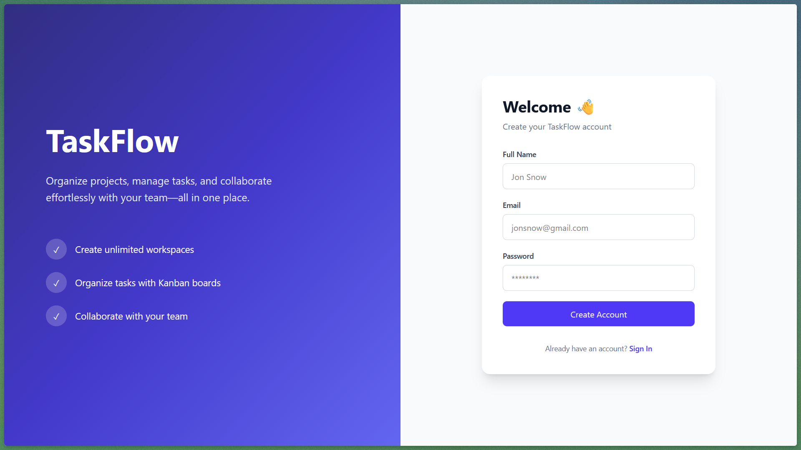

# TaskFlow

**TaskFlow** is a full-stack project management application inspired by tools like Trello. Create workspaces, manage tasks on a Kanban board, and collaborate with your team — all in one place.

🔗 **Live Demo**: [taskflow-lunar.vercel.app](https://taskflow-lunar.vercel.app)

---

## Screenshots

| Auth | Dashboard |
|---|---|
|  |  |

| Kanban Board | Workspace |
|---|---|
|  |  |

| Invitations |
|---|
|  |

---

## Features

### 🔐 Authentication
- User registration and login
- Password hashing with **bcrypt**
- **JWT**-based stateless authentication
- Protected API routes and frontend routes
- Persistent sessions via localStorage

### 🗂️ Workspaces
- Create and manage multiple workspaces
- Workspace roles: **Owner** and **Member**
- Workspace-specific task management

### 📨 Workspace Invitations
- Owners can invite members by email
- Users can **accept** or **reject** pending invitations
- Invitation validation:
  - Owner-only invite permissions
  - Duplicate membership & invite checks
  - Invitation expiry

### ✅ Task Management
Tasks support:
- **Title** and **Description**
- **Status**: `TODO` → `IN_PROGRESS` → `IN_REVIEW` → `DONE`
- **Priority**: `LOW`, `MEDIUM`, `HIGH`
- **Assignee** and **Creator**
- **Due Date**
- Drag-and-drop Kanban board

---

## Tech Stack

### Frontend
| Technology | Purpose |
|---|---|
| React 19 | UI framework |
| TypeScript | Type safety |
| Vite | Build tool |
| Tailwind CSS v4 | Styling |
| React Router v7 | Client-side routing |
| Axios | HTTP client |
| dnd-kit | Drag and drop |
| Lucide React | Icons |

### Backend
| Technology | Purpose |
|---|---|
| Node.js + Express v5 | REST API server |
| TypeScript | Type safety |
| Prisma v7 | ORM |
| PostgreSQL | Database |
| bcrypt | Password hashing |
| JSON Web Tokens | Authentication |
| Zod | Request validation |

### Infrastructure
| Service | Purpose |
|---|---|
| Vercel | Frontend hosting |
| Render | Backend hosting |
| Neon | Serverless PostgreSQL |
| GitHub | Version control |

---

## Project Structure

```
TaskFlow/
├── client/                 # React + Vite frontend
│   ├── src/
│   │   ├── api/            # Axios instance
│   │   ├── components/     # Reusable UI components
│   │   ├── context/        # Auth context
│   │   ├── hooks/          # Custom hooks
│   │   ├── layouts/        # Page layouts
│   │   ├── pages/          # Route pages
│   │   ├── routes/         # Protected route wrappers
│   │   ├── services/       # API service functions
│   │   └── types/          # TypeScript types
│   └── vercel.json         # Vercel SPA routing config
│
└── server/                 # Express + Prisma backend
    ├── prisma/
    │   ├── schema.prisma   # Database schema
    │   └── migrations/     # Migration history
    └── src/
        ├── middlewares/    # Auth, error, validation
        ├── modules/        # Auth, workspace, task modules
        ├── routes/         # Invitation routes
        ├── services/       # Business logic
        ├── utils/          # AppError, asyncHandler, JWT
        └── server.ts       # Entry point
```

---

## Getting Started (Local Development)

### Prerequisites
- Node.js 18+
- A PostgreSQL database (or a free [Neon](https://neon.tech) project)

### 1. Clone the repository

```bash
git clone https://github.com/im-lunar/TaskFlow.git
cd TaskFlow
```

### 2. Setup the backend

```bash
cd server
npm install
```

Create a `.env` file in the `server/` directory:

```env
DATABASE_URL="your_postgresql_connection_string"
JWT_SECRET="your_secret_key"
PORT=3000
```

Run database migrations and start the server:

```bash
npx prisma migrate deploy
npm run dev
```

### 3. Setup the frontend

```bash
cd ../client
npm install
```

Create a `.env` file in the `client/` directory:

```env
VITE_API_URL=http://localhost:3000/api/v1
```

Start the development server:

```bash
npm run dev
```

The app will be available at `http://localhost:5173`.

---

## Database Schema

```
User
 ├── owns → Workspace[]
 ├── member of → WorkspaceMember[]
 ├── created → Task[]
 ├── assigned → Task[]
 └── sent → WorkspaceInvitation[]

Workspace
 ├── owner → User
 ├── members → WorkspaceMember[]
 ├── tasks → Task[]
 └── invitations → WorkspaceInvitation[]

Task
 ├── workspace → Workspace
 ├── creator → User
 └── assignee → User?

WorkspaceInvitation
 ├── workspace → Workspace
 └── invitedBy → User
```

---

## License

This project is open source and available under the [MIT License](LICENSE).
